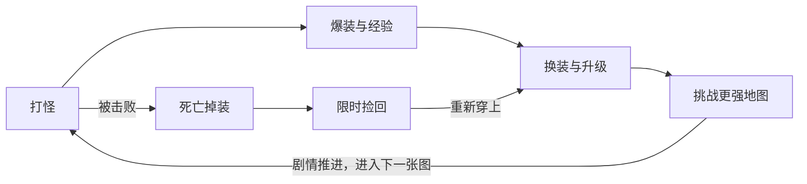
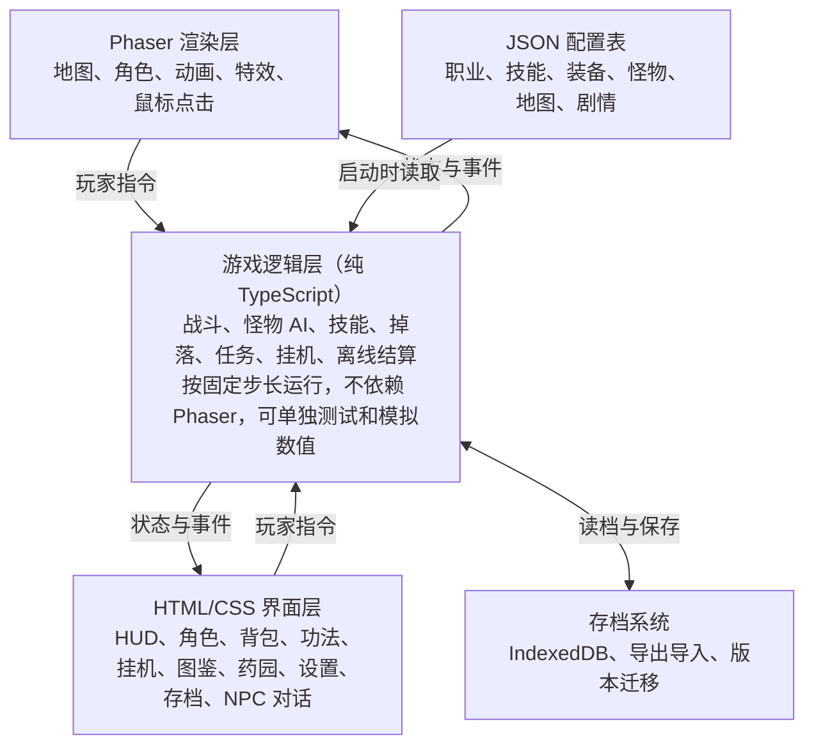

# 单机传奇网页游戏设计文档

Nov 1, 2026 · @Henry X

> 在线版：<https://claude.ai/artifact/RPbNiCTZDu6G7P4e7f8LUP>

## 概述

《修仙传奇》是一款在浏览器里运行的单机传奇类游戏，保留手动打怪爆装的怀旧手感，并用适度挂机减少重复劳动。世界观沿用《凡人修仙传》，主角名字由玩家自定义。

- **产品定位**：传奇世界风格的 2.5D 单机修仙角色扮演游戏，无需服务器。
- **目标玩家**：首先是作者本人，暂不面向公众。
- **设计目标**：打怪、爆装、变强的循环要好玩，一个人玩也不冷清。
- **非目标**：首版不做联网、多人对战和付费系统。

## 版本范围

> 2026-11-05 16:20 按 `public/data/` 与源码重新盘点。

等级上限已扩到 70 级，包含体修、法修、御灵修士三个职业。第 1～9 章已完成，1～55 级可以一路玩到人界篇收束（昆吾山诛血焰、镇魔塔第九层灭元刹）。第 10～12 章（55～70 级）在设计阶段：系统扩展（等级、境界、功法、丹药、药园）已完成，雪原地表、两档法器、章节内容尚未开始，方案见 `docs/chapters-10-12-plan.md`。

素材全部用免费资源，角色用 CC0 的 KayKit 模型改色后预渲染，风格是偏可爱的 Q 版修仙，游戏仅自用。人名、地名、设定和道具直接沿用《凡人修仙传》，暂不做原创内容。代码中所有素材和名称都可替换，日后如要公开发布，必须先全部换成原创内容。非 CC0 素材要记录来源和授权。

## 核心玩法循环

玩家的动力来自打怪、爆装、变强的循环，剧情负责打开新地图，死亡掉装负责制造紧张感。



- **短循环**：几分钟内清怪、捡掉落、补药。
- **中循环**：几小时内升级、学技能、击败章节 Boss。
- **长循环**：通关主线，并反复刷 Boss 追求极品。

自动挂机替代重复的短循环，打 Boss 和推剧情仍由玩家手动完成。

## 职业与战斗

玩家只操作一个角色，没有队友系统，三个职业靠不同的输出方式形成差异。技能名称写内容时从原著功法和神通中选，这里只定效果。

| 职业 | 原型 | 定位 | 主属性 | 首版技能方向 |
| --- | --- | --- | --- | --- |
| 体修 | 战士 | 近战，精于硬扛 | 攻击 | 单体重击、直线穿刺、环形范围斩 |
| 法修 | 法师 | 远程，高伤脆皮 | 魔法 | 单体法术、范围法术、击退、护盾 |
| 御灵修士 | 道士 | 远程持续伤害与召唤 | 道术 | 持续毒伤、治疗、增益、召唤灵虫或傀儡 |

属性沿用传奇体系：攻击、魔法、道术、防御、魔防都是上下限区间，另有生命、魔法值、命中、闪避、幸运。

每次命中都在区间内各掷一次攻击和防御：

```latex
\text{伤害} = \max(1,\ \text{攻击掷点} - \text{防御掷点})
```

幸运会提高攻击掷出上限的概率，所以武器幸运直接影响输出。法术伤害用魔法或道术对魔防计算。公式系数在数值模拟后确定。

## 成长与经济

首次练到 40 级的目标是约 30 小时游戏时间，前期升级快，后期逐渐变慢。这个时长按在线时间计算，不含离线收益。

- **装备栏位**：武器、衣服、头盔、项链、手镯 2 个、戒指 2 个。
- **极品随机属性**：同名装备掉落时随机附加属性，极品是主要的长期追求。
- **武器幸运**：用消耗道具冲幸运，有成功也有失败。
- **掉落表**：每种怪物的每条掉落独立判定，Boss 是高阶装备的主要来源。
- **爆率**：单机没有玩家交易，所有装备都要自己打，因此爆率需按单人重新设计，不沿用原版。
- **灵石**：来自打怪和卖店，花在丹药、功法、传送阵和祭炼材料上。
- **境界**：等级表不变，界面上按等级显示境界，当前写到化神。练气 1～13、筑基 14～26、结丹 27～34、元婴 35～65（35～40 初期、41～60 中期、61～65 后期）、化神 66～70。
- **突破**：大境界前的等级封顶，要集齐材料并用突破丹药才能继续升级，比如筑基丹，突破可能失败。当前四道关：筑基（筑基丹 + 蛟鳞 3）、结丹（降尘丹）、元婴（定灵丹）、化神（魔元丹 + 五色寒焰）。

突破的初始数值如下。失败后成功率累积，最高到 100%，所以不会卡死，具体数值试玩后再调：

| 境界 | 所需丹药 | 初始成功率 | 每次失败加成 | 最多失败 |
| --- | --- | --- | --- | --- |
| 筑基 | 筑基丹 + 蛟鳞×3 | 60% | +15% | 3 次 |
| 结丹 | 降尘丹 | 40% | +15% | 4 次 |
| 元婴 | 定灵丹 | 25% | +15% | 5 次 |
| 化神 | 魔元丹 + 五色寒焰 | 25% | +15% | 5 次 |

失败时消耗本次的丹药和材料，并虚弱 10 分钟，属性降低 20%。不掉级、不扣经验、不丢装备。

数值先用表格设计，再用脚本模拟各等级的升级耗时和每小时产出，确认能对上 30 小时的目标。

## 世界与内容

首版用完整剧情串联所有地图，故事取材于《凡人修仙传》人界篇，主角是玩家自定义的新角色，不扮演韩立。原著中韩立的主要经历由主角承担，韩立本人不登场。下表是工作规划：第 1～9 章已实现，共 34 张地图（1～55 级）；第 10～12 章（55～70 级）的方案见 `docs/chapters-10-12-plan.md`。

| 区域 | 等级 | 境界 | 地图类型 | 剧情作用 |
| --- | --- | --- | --- | --- |
| 黄枫谷等主城 | 全程 | 全程 | 主城 | 拜入宗门、NPC、商店、复活点 |
| 彩霞山 | 1～7 | 练气 | 野外 | 教学，七玄门与野狼帮的冲突 |
| 太南山 | 7～11 | 练气 | 野外 | 太南小会，踏入修仙界 |
| 血色禁地 | 11～13 | 练气到筑基 | 副本 | 试炼夺药，第一个剧情 Boss |
| 燕翎堡 | 14～26 | 筑基 | 野外 | 魔道六宗入侵，分燕翎堡、灵矿、金鼓原三张图 |
| 虚天殿 | 27～34 | 结丹 | 副本 | 先在天星城和外星海立足，再进三层的虚天殿争夺虚天鼎 |
| 坠魔谷 | 35～40 | 元婴初期 | 副本 | 外谷、内谷、血咒之门三张图，古魔主魂被灭、分魂逃出谷外 |
| 天澜草原 | 40～45 | 元婴中期 | 野外 | 赴大晋途中噬金虫暴露，被突兀仙师追杀，混入苍鹭部；慕兰边境是第 6 章开头的支线 |
| 大晋（第 8 章，已完成） | 45～50 | 元婴中期 | 野外与副本 | 晋西坊市、方尖山、冯家密窟、苦竹岛；血焰分魂化名「韩长老」混入皇族叶家 |
| 昆吾山（第 9 章，已完成） | 50～55 | 元婴中期 | 野外与副本 | 南疆坊市、万毒谷·阴阳窟、昆吾山、镇魔塔四层；诛血焰、灭元刹，人界篇收束 |
| 北夜小极宫～五龙海（第 10～12 章，规划中） | 55～70 | 元婴后期到化神 | 野外与副本 | 小极宫翻脸、困于虚天殿、重返乱星海、攻取元磁神山、化神、偷渡灵界 |

- **主线**：每张地图一章，带玩家走完整条等级线。主角只为活下去和求长生，不是救世，所以每章围绕突破所需的资源展开。
- **支线**：由各地 NPC 提供，补充世界观，并给经验和道具。
- **怪物与 Boss**：每张图有多种常规怪，每张图至少 1 个 Boss，野外 Boss 定时刷新，可反复刷极品。
- **地图规模**：野外地图做到 120×120，走路穿过一条边约 34 秒，怪物按小区域分布并保持间距，每只约占 220 个可走格。主城做到 40×40。目前 34 张，tmj 全部已生成：120×120 八张（彩霞山、太南山、金鼓原、外星海、坠魔谷·外谷、天澜草原、方尖山、万毒谷·阴阳窟）；100×100 八张（血色禁地、燕翎堡、灵矿、虚天殿·鬼雾、坠魔谷·内谷、突兀营地、冯家密窟、昆吾山）；90×90 一张（虚天殿·冰火道）；70×70 六张（虚天殿·鼎殿、血咒之门、圣兽降临之地、慕兰边境、苦竹岛、镇魔塔·一层）；60×60 两张（镇魔塔·二、三层）；50×50 一张（镇魔塔·第九层）；40×40 八座主城（七玄门、黄枫谷、太南谷、天星城、落云宗、苍鹭部、晋西坊市、南疆坊市）。
- **内容核对**：上表的章节安排按游戏节奏调整，不完全遵循原著时间线。写剧情时再对照原著核对人物和细节。

主线共 9 章，第 1～9 章已实现，覆盖 1～55 级。第 6 章的最终 Boss 是魔化的南陇侯，击杀后古魔主魂被谷中禁制绞灭、一缕分魂逃出谷外，这缕分魂是第 9 章的最终 Boss：

| 章 | 地图 | 主要剧情 | Boss | 章末收获 |
| --- | --- | --- | --- | --- |
| 1 | 彩霞山 | 主角入七玄门，随墨大夫学艺，击败野狼帮请来的修仙者 | 金光上人 | 升仙令 |
| 2 | 太南山 | 路遇枯崖山万小山，随他入太南谷，赴青颜真人主持的太南小会，向菡云芝换金竺笔，被青纹道人一伙盯上，到升仙大会打擂台 | 青纹道人（上擂台是游戏安排） | 筑基丹，持升仙令入黄枫谷 |
| 3 | 血色禁地 | 入禁地采玉髓芝、紫猴花、天灵果，他派弟子互相抢夺，天阙堡封岳截杀掩月宗多宝女，主角与南宫婉联手斩墨蛟 | 封岳、墨蛟 | 把主药交给李化元，换第二枚筑基丹，拜入李门 |
| 4 | 燕翎堡、灵矿、金鼓原 | 随董萱儿赴燕翎堡，王蝉在婚礼上以阴火大阵困住修士，主角突围；魔道入侵后镇守灵矿，在地底古阵夺得大挪移令；七派在金鼓原布防后弃越国撤离，主角经古传送阵逃入乱星海 | 王蝉（击退）、血煞护法、魔道统领（后两个是游戏安排） | 在天星城结丹 |
| 5 | 天星城、外星海、虚天殿 | 主角在天星城落脚结丹，到外星海猎妖；乌丑持虚天残图，以禁制逼主角同入虚天殿；殿分鬼雾、冰火道、鼎殿三层，玄骨上人拉拢主角除掉徒弟极阴，事后又要独占虚天鼎 | 海妖王（游戏安排）、极阴祖师、玄骨上人（反目是游戏安排） | 带虚天鼎逃离，拿到定灵丹，回天南入落云宗结婴 |
| 6 | 落云宗、坠魔谷 | 主角回天南入落云宗；南陇侯约主角和鲁卫英入谷探宝，他破除血咒之门的禁制，被古魔夺舍，鲁卫英遇害 | 守谷魔将（游戏安排）、魔化的南陇侯 | 活着逃出坠魔谷，回落云宗复命；古魔分魂逃出谷外，为第 9 章埋线 |
| 7 | 天澜草原、苍鹭部、慕兰边境 | 主角第二元婴大成后赴大晋，途经天澜草原时噬金虫暴露，被突兀仙师追杀、煞气反噬；混入苍鹭部救下枫岳，得冯家密窟钥匙；天澜圣女召圣兽分身下界，伙同两位大仙师追杀，主角分化脱身、擒获圣兽分身得圣鼎，自封于冰中顺舜江漂向大晋 | 呼大仙师、天澜圣女、圣兽分身；慕兰边境支线的乐上师 | 圣鼎与冯家密窟钥匙，抵达大晋 |
| 8 | 晋西坊市、方尖山、冯家密窟、苦竹岛 | 主角被曹梦容所救后在大晋静养，赴参王大会、学炼器；在苦竹岛比试胜苦竹老人得乌凤翎；血焰分魂化名「韩长老」混入皇族叶家 | 殷姓魔修（精英）、方尖山二魔、苦竹老人 | 乌凤翎，察觉血焰分魂 |
| 9 | 南疆坊市、万毒谷·阴阳窟、昆吾山、镇魔塔 | 与富成、白瑶怡在阴阳窟捕阴芝马，遭十级妖兽银翅夜叉；叶家开启昆吾封印，众人被传入山中；得天晶碑、太阴真火，收服圭灵；与阴罗宗乾老魔交手；协助诛杀血焰、夺回青竹蜂云剑；镇魔塔第九层灭元刹、得八灵尺，被送出山 | 银翅夜叉、乾老魔、血焰（血海机制）、元刹 | 青竹蜂云剑、八灵尺，人界篇收束 |

- **第 10～12 章（规划）**：55～70 级，北夜小极宫、雪连山、冰海、玄玉洞、虚天殿·古禁、魔湖岛、魁星岛、星宫、坠魔谷·魔气深渊、五龙海·空间节点，最终 Boss 域外天魔。方案见 `docs/chapters-10-12-plan.md`；系统扩展已做完，章节内容未开始。

- **主城衔接**：第 1 章在七玄门，第 2 章在太南谷，第 3～4 章在黄枫谷，第 5 章在天星城，第 6 章在落云宗，第 7 章在苍鹭部，第 8 章在晋西坊市，第 9 章在南疆坊市。它们功能相同，可复用同一套场景素材。
- **结局**：人界篇在第 9 章昆吾山收束（诛血焰、灭元刹），主角没有拯救世界，只是又活了下来；第 12 章偷渡灵界后另起灵界篇。
- **资料依据**：大纲只按小说整理，不参考动画和电视剧。资料来自[小说百科](https://baike.weixin.qq.com/v64358540.htm?baike_inner=tv)和[原著对比文章](https://www.163.com/dy/article/K5OD300J0523SA0G.html)等二手内容，未逐章对照原文。

系统内容统一用修仙叫法，配置表 ID 可以保持原样：

| 传奇叫法 | 修仙叫法 |
| --- | --- |
| 金币 | 灵石 |
| 药水 | 丹药 |
| 技能书 | 功法 |
| 装备与极品属性 | 法器与品阶 |
| 武器冲幸运 | 祭炼法宝 |
| 传送 | 传送阵 |
| 离线收益 | 闭关 |
| 宝宝 | 灵虫或傀儡 |

## 单机化设计

首版只做自动挂机和离线收益，其余单机化内容放到后续版本。

| 内容 | 说明 | 版本 |
| --- | --- | --- |
| 自动挂机 | 自动打怪、自动拾取 | 首版 |
| 离线收益 | 关掉游戏后仍有收益 | 首版 |
| 假人散修 | AI 散修打怪、喊话、抢 Boss、杀人夺宝 | 后续 |
| 模拟宗门大战 | AI 宗门定期发起沙城式大战 | 后续 |
| 模拟坊市 | 向 AI 买卖法器 | 后续 |
| 掌天瓶灵药园 | 用掌天瓶催熟灵药，炼制丹药 | 药园与炼丹已做（G 键，第 1～2 批）；成就、HUD 成熟提示、模拟校准未做，方案见 `docs/garden-plan.md` |

首版规则如下：

- **死亡惩罚**：每次死亡 30% 概率随机掉 1 件身上装备。1～10 级不掉装，死后 5 分钟内再死也不掉。
- **掉落找回**：装备留在死亡地点，30 分钟游戏内时间内可捡回，超时后消失。小地图标出位置和剩余时间。
- **在线挂机**：角色会死，掉装概率减半为 15%，可设低血自动回城。
- **离线收益**：角色不会死亡，最多累计 8 小时，效率为在线的 50%。
- **离线法器**：只产出挂机地图常规怪的普通法器，不出极品和 Boss 掉落，单次最多 10 件，背包放不下时自动换成灵石。

## 界面与操作

操作以鼠标为主，技能用快捷键，首版只支持桌面浏览器（没有触屏操作）。

| 操作 | 效果 |
| --- | --- |
| 左键点地面 | 寻路走路 |
| 右键点地面 | 寻路跑步，速度是走路的 1.7 倍 |
| 按住左键或右键 | 朝鼠标方向持续走路或跑步 |
| 左键点怪 | 锁定并持续攻击 |
| 左键点地上物品 | 走过去拾取 |
| F1～F10 或 0～9 | 释放功法或使用丹药。快捷栏 10 格：功法 8 格 + 丹药 2 格 |
| 空格 | 一键捡起附近的法器 |
| T | 使用传送戒 |
| M | 静音开关 |
| C / B / K / A / J / G / O | 角色、背包、功法、挂机、图鉴、药园与炼丹、设置 |
| Esc | 关闭面板 |
| 左键点 NPC | 对话、商店、仓库、传送阵 |
| 点 HUD 里的任务 | 自动寻路到任务目标 |

- **常驻 HUD**：生命/灵力/经验条、10 格快捷栏、小地图、任务追踪、Boss 血条（12 格内显示）、系统消息、挂机状态。
- **已有面板**：角色（装备与属性）、背包（8 列图标网格、拖拽与丢弃）、功法、挂机、图鉴（妖兽/法器/成就）、药园与炼丹、设置（主音量/音乐/音效三条滑杆、画质高低、飘叶开关、恢复默认，存 localStorage）、存档（保存/导出/导入/删除）、NPC（商店/仓库/批量卖出/传送/对话）。
- **还没有的**：独立任务面板（任务只走 HUD 追踪）。
- **挂机设置**：拾取法器的最低品阶、自动吃药阈值、低血自动回城阈值（0 为不回城）。
- **存档**：3 个槽位，开局在开始界面选槽（每槽显示角色、职业、境界和上次保存时间），进游戏后槽位固定；面板里可「存入」其他槽做备份、「清空」或「返回开始界面」换槽/换职业。旧版的单槽存档第一次启动时自动搬到 1 号槽，`SAVE_VERSION = 6`。
- **离线结算弹窗**：回到游戏时显示离线时长、经验、灵石、法器与药园收成。

## 技术架构

游戏是纯前端静态网页，用 Phaser 3、TypeScript 和 Vite 开发，地图用 Tiled 编辑，没有后端。



逻辑层不访问渲染对象，所以离线结算、自动化测试和数值模拟都能直接复用同一套代码。

```
src/
  game/      游戏逻辑，不依赖 Phaser
  render/    Phaser 场景和动画
  ui/        HTML/CSS 界面
  save/      存档与迁移
public/
  data/      JSON 配置表
  assets/    可替换的美术和音效
  maps/      Tiled 地图
tools/       数值模拟脚本
```

## 数据与存档

所有游戏内容都写在 JSON 配置表里，存档只保存玩家状态和配置 ID，改数值不用改代码。

| 配置表 | 内容 |
| --- | --- |
| `classes.json` | 职业初始属性和成长 |
| `levels.json` | 升级所需经验（到 70 级） |
| `realms.json` | 境界划分、突破材料和成功率、化神时领悟的功法 |
| `skills.json` | 功法效果、消耗、冷却，进阶功法用 `replaces` 原位替换 |
| `items.json` | 法器、丹药、材料、功法书、符的基础属性 |
| `affixes.json` | 极品随机属性池与品阶 |
| `sets.json` | 套装及其加成 |
| `monsters.json` | 怪物属性和 AI 类型、特殊能力、召唤 |
| `drops.json` | 各怪物掉落表、Boss 首杀保底 |
| `maps.json` | 地图、传送点、刷怪点、地形色调、音乐 |
| `npcs.json` | NPC 位置、商店、仓库、传送、对话 |
| `quests.json` | 主线与支线任务、目标、奖励 |
| `dialogues.json` | 剧情对话文本 |
| `garden.json` | 药园地块、灵药、绿液、丹药配方 |
| `achievements.json` | 成就条件与奖励 |
| `game.json` | 起始地图、职业、全局参数 |

存档存在 IndexedDB，并支持导出和导入 JSON 文件，防止清除浏览器数据后丢档。

- **槽位**：`saves` 表里用 `slot-1`、`slot-2`、`slot-3` 三个键各存一份完整存档；`localStorage` 的 `xiuxian-slot` 记上次玩的槽位，开局默认选中。旧版的 `main` 键在第一次读槽位时搬到 1 号槽后删除，老玩家不用手动迁移。
- **内容**：角色属性、背包与仓库、装备实例、任务进度、当前地图、挂机与拾取设置、药园（地块、绿液、收获统计）、图鉴与击杀数。
- **死亡掉落**：地上待捡回的装备写入存档，关掉游戏不会丢失，限时按游戏内时间计算。
- **离线结算**：保存上次在线时间和挂机地图，回来时按最多 8 小时、效率 50% 结算，并带上药园收成。
- **版本迁移**：存档带版本号（当前 `SAVE_VERSION = 6`，有 `MIGRATIONS` 表）。开发阶段可以破坏旧存档，正式发布后每次格式变化都写迁移函数，逐版升级。
- **保存时机**：定时自动保存，并在切图、死亡、捡到装备、页面隐藏时立即保存。

## 开发里程碑

一个人业余开发，完整版预计需要 6 个月以上，完整剧情可能让它更长。每个阶段通过验收点才进入下一阶段。

| 阶段 | 时长 | 内容 | 验收点 |
| --- | --- | --- | --- |
| M1 可玩原型 | 2～4 周 | 一张图打怪掉落 | 打怪手感好玩 |
| M2 核心系统 | 2～3 个月 | 三职业与全部系统，含境界突破 | 系统全部串通 |
| M3 内容与剧情 | 时长待评估 | 全部地图和主线 | 1～55 级可通关（第 1～9 章已完成；三职业手动通关仍待试玩） |
| M4 打磨 | 时长待评估 | 音效、引导、性能 | 待做：设置面板、新手引导、资源体积 |
| M5 55～70 级（新增） | 时长待评估 | 第 10～12 章、雪原地表、化神 | 1～70 级可通关，方案见 `docs/chapters-10-12-plan.md` |

M3 和 M4 的时长在 M2 结束后，根据美术产能和剧情大纲再评估。

## 差距与待补充

对比传奇，手感和系统的差距已大幅缩小，第 1～9 章主线全部完成，最大的缺口是 55～70 级的第 10～12 章、试玩打磨和通关后玩法。下表是 **2026-11-05 16:20** 的盘点，数字按 `public/data/` 与 `src/` 实际统计（内容仍在增加，重新盘点时请以数据为准），传奇部分来自记忆，后续继续补充。

| 内容 | 现状 | 目标 |
| --- | --- | --- |
| 地图 | 34 张，tmj 全部已生成；尺寸分布见上文「地图规模」。8 座主城、26 张野外或副本 | 第 10～12 章约 10 张新图（2 张复用） |
| 怪物 | 82 种，含远程、放毒、冲锋、召唤 | 第 10～12 章 18 种常规怪 |
| Boss | 23 个，带技能、召唤和狂暴阶段（魔化南陇侯、血焰都是两段狂暴），每个 Boss 都配了一件专属法器 | 第 10～12 章 8 个 |
| 法器 | 64 件，覆盖 1～54 级；含 4 枚特殊戒指、23 件 Boss 专属、5 套套装（青元、玄天、元磁、天澜、昆吾） | 补 60、68 两档，覆盖到 70 级 |
| 功法 | 42 门，三职业各 14：7 门基础 + 3 门大成 + 3 门圆满（57/62/67 级）+ 元磁神光（65 级化神时领悟）；36 本功法书，残卷升层 | 70 级前已够用 |
| 药园与炼丹 | 9 种灵药、14 张丹方、2～6 块地；绿液按境界 4 档，化神复用元婴档；炼丹必成 | 第 3 批：药园成就、HUD 成熟提示、模拟校准 |
| 任务和 NPC | 9 章 108 个主线（ch1 7、ch2 8、ch3 7、ch4 15、ch5 16、ch6 13、ch7 12、ch8 14、ch9 15，加入门 1）+ 28 个支线；63 个 NPC，其中 8 个有商店、8 个有仓库 | 第 10～12 章约 42 个主线 + 3～4 个支线 |
| 成就与图鉴 | 27 个成就；妖兽、法器图鉴和物品来源（掉落率需击杀 50 只才揭晓） | 随新章节补充 |
| 音效和音乐 | 13 个音效 + 13 首曲（12 首场景 + 1 首 Boss）；8 座主城不单独配乐，回落到 town | 第 10～12 章补 2～3 首 |
| 正式美术 | 三职业、NPC、怪物、地图；图标 178 张矢量 + 48 张高清位图（hd 优先、掉落用透明矢量，12 门新功法已单独出图）；山魈是猴形妖兽 | 雪原地表、后续章节图标 |
| 界面 | 角色、背包、功法、挂机、图鉴、药园、设置、存档、NPC 九类面板；任务只有 HUD 追踪；设置存本机 localStorage | 独立任务面板 |
| 存档 | IndexedDB 3 槽 + 导出导入；旧单槽自动迁移到 1 号槽；记住上次玩的槽位；`SAVE_VERSION = 6` | 更多槽位或云存档 |
| 资源体积 | `public/assets` 53MB（精灵 24MB、音频 23MB、道具 3.6MB、图标 2.5MB），已按地图懒加载 | 音频按需加载、贴图压缩 |

按下面的顺序推进，手感优先，因为它不依赖正式美术，手感不好时内容再多也撑不起几十小时。

### 第一步：手感

- [x] 音效和背景音乐
- [x] 极品掉落的光柱、音效和提示
- [x] 法器属性对比
- [x] 拾取优化：灵石 6 格内自动吸取，丹药和材料 2 格内自动拾取，法器按空格一键捡
- [x] 怪物种类：远程、放毒、召唤、冲锋，以及带技能的 Boss

### 第二步：传奇特色

- [x] 功法书和功法升级：主城商店按等级卖本职业的功法书，残卷升层
- [x] 各职业的招牌技能：体修撼山冲（冲锋定身），法修火墙术、御灵修士瘴毒术（持续地面伤害）
- [x] 特殊法宝：对应传奇的麻痹戒、复活戒、护身戒、传送戒
- [x] 套装属性：5 套，2/4/6 件三档加成
- [x] 多层副本：虚天殿三层、镇魔塔四层，按任务解锁下一层
- [x] Boss 刷新提示
- [x] Boss 专属掉落：23 个 Boss 各有一件专属法器，首杀必掉，之后 8%；Boss 掉的法器至少中品
- [x] 回城符和随机传送符
- [x] 仓库和批量卖出
- [x] 点任务自动寻路
- [x] 进阶功法：大成（42/47/52 级）与圆满（57/62/67 级）原位替换，层数带走

### 第三步：内容

- [x] 余下的地图、怪物、Boss 和法器
- [x] 第 1～9 章主线和支线：108 个主线、28 个支线，覆盖 1～55 级
- [x] 第 8 章大晋、第 9 章昆吾山：地形、怪物、Boss、任务、音乐、成就全部完成
- [ ] 第 10～12 章（55～70 级）：系统扩展已做，10 张新图、18 种常规怪、8 个 Boss、约 42 个主线未开始

### 第四步：单机活力

- [ ] 假人散修：AI 散修打怪、喊话、抢 Boss、杀人夺宝。成本低、收益大，建议排在章节内容之后
- [ ] 排行榜：和假人比较，依赖假人散修
- [x] 图鉴和成就：妖兽、法器图鉴和 27 个成就，J 键打开；物品说明里列出来源，怪物掉落随图鉴逐步揭开
- [ ] 通关后玩法：无尽爬塔（复用现有地表，成本最低）、高难度秘境、换职业开新档、宗门大战

### 第五步：55～70 级与打磨（新增）

- [ ] 雪原地表：`groundPainter.ts` 目前只有一套草地配色，`MapDef` 只有 `tone` 叠加，没有按地表格换配色
- [ ] 两档法器（60、68 级）与 7～8 件 Boss 专属
- [ ] 药园第 3 批：药园成就、HUD 成熟提示、`tools/simulate.ts` 的药园供给统计
- [x] 设置面板（O 键）：主音量/音乐/音效三条滑杆（0～100%，默认 70/50/80 与原来的听感对齐）、画质高低（低画质关水面波光、飘叶间隔翻倍）、飘叶开关、恢复默认；存在 localStorage，不进存档，M 键静音保留
- [x] 多存档槽：3 个槽位（`slot-1..3`），开始界面选槽、显示角色/职业/境界/上次保存时间，面板可互拷、清空、返回开始界面；旧 `main` 键第一次读到自动搬到 1 号槽，上次玩的槽位记在 localStorage
- [ ] 手动全程通关验证：模拟只覆盖挂机，三职业手动到底多久仍待试玩
- [ ] 音频按需加载：23MB 音频在解锁时一次性载入音效

暂不做耐久修理和负重，也不做坐骑、翅膀、VIP 和日常签到。

## 风险与待决问题

最大的风险是美术一致性和剧情文案量，它们都会拖慢进度，应在原型阶段就验证。

| 风险 | 影响 | 应对 |
| --- | --- | --- |
| 免费素材没有配套的怪物模型 | 怪物和角色风格对不上 | 优先找同风格的 CC0 低模怪物，先验证 1 种再铺开 |
| 修仙题材素材包少，飞剑动作难做 | 美术进度变慢，风格不统一 | 角色沿用近身挥砍动作，飞剑只放在技能特效里 |
| 直接沿用原著内容 | 不能公开发布 | 名称和文本都走配置表，公开前全部替换 |
| 完整剧情文案量大 | 时间明显拉长 | 先写故事大纲，剧情放在核心系统之后填充 |
| 原版掉装惩罚加单机无交易 | 极品丢失后难以补回，打击大 | 试玩后调整掉落概率和捡回限时 |
| 在线挂机可能在无人看管时掉装 | 体验差 | 低血自动回城默认开启，挂机掉落时明确提示 |
| 挂机收益过高 | 手动打怪失去意义 | 在数值模拟中分别算手动、挂机、离线三档产出 |

待决问题：

- [x] 游戏正式名称是什么？修仙传奇。
- [x] 世界观背景怎么定？沿用《凡人修仙传》。
- [x] 每章的故事大纲和最终 Boss 是什么？见“世界与内容”的主线大纲。
- [x] 突破失败有什么惩罚，成功率是多少？见“成长与经济”，试玩后再调。
- [x] 死亡时装备掉落概率和捡回限时是多少？见“单机化设计”的首版规则，试玩后再调。
- [x] 离线收益是否包含法器，还是只有经验和灵石？包含普通法器，见“单机化设计”的首版规则。
