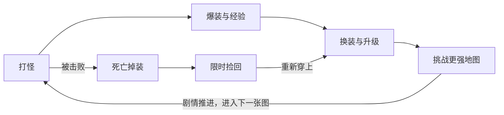
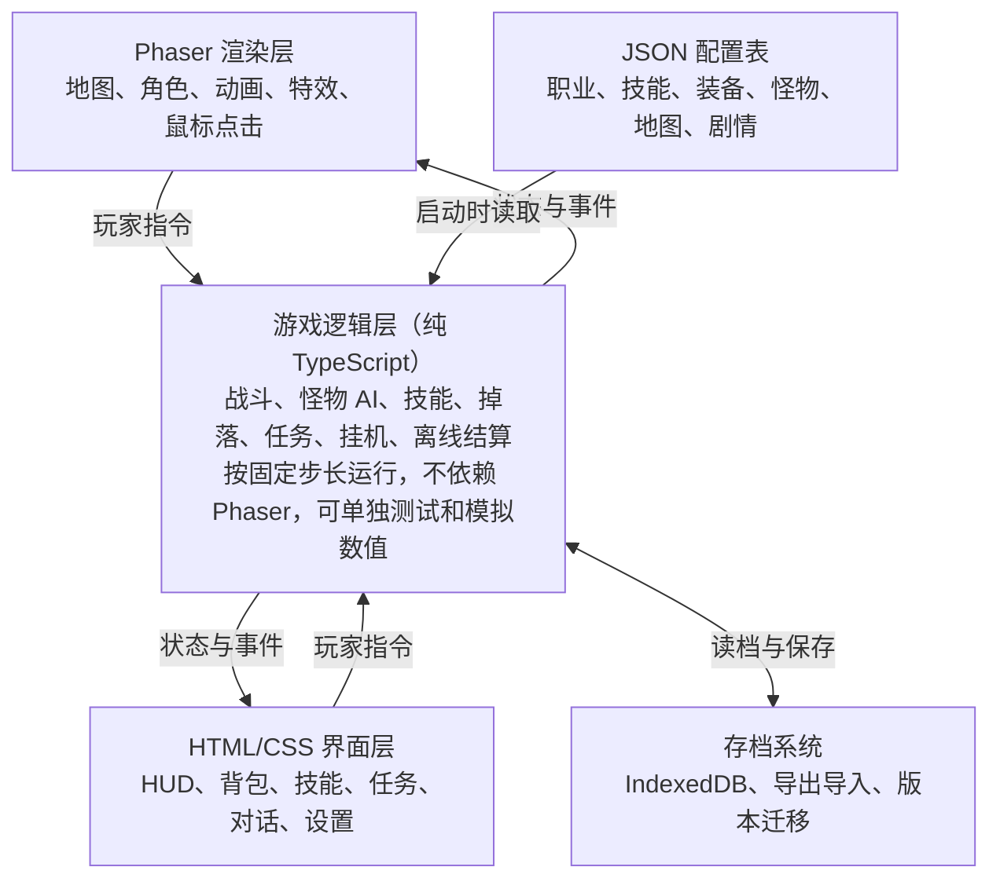

# 单机传奇网页游戏设计文档

Nov 1, 2026 · @Henry X

> 在线版：<https://claude.ai/artifact/RPbNiCTZDu6G7P4e7f8LUP>

## 概述

《修仙世界》是一款在浏览器里运行的单机传奇类游戏，保留手动打怪爆装的怀旧手感，并用适度挂机减少重复劳动。世界观沿用《凡人修仙传》，主角名字由玩家自定义。

- **产品定位**：传奇世界风格的 2.5D 单机修仙角色扮演游戏，无需服务器。
- **目标玩家**：首先是作者本人，暂不面向公众。
- **设计目标**：打怪、爆装、变强的循环要好玩，一个人玩也不冷清。
- **非目标**：首版不做联网、多人对战和付费系统。

## 版本范围

首个完整版本做到 40 级，包含体修、法修、御灵修士三个职业，约 1 张主城和 5～8 张野外或副本图。

素材用 AI 生成加商用素材包，游戏仅自用。人名、地名、设定和道具直接沿用《凡人修仙传》，暂不做原创内容。代码中所有素材和名称都可替换，日后如要公开发布，必须先全部换成原创内容。商用素材包购买时要留存授权证明。

## 核心玩法循环

玩家的动力来自打怪、爆装、变强的循环，剧情负责打开新地图，死亡掉装负责制造紧张感。



- **短循环**：几分钟内清怪、捡掉落、补药。
- **中循环**：几小时内升级、学技能、击败章节 Boss。
- **长循环**：通关主线，并反复刷 Boss 追求极品。

自动挂机替代重复的短循环，打 Boss 和推剧情仍由玩家手动完成。

## 职业与战斗

玩家只操作一个角色，没有队友系统，三个职业靠不同的输出方式形成差异。技能名称写内容时从原著功法和神通中选，这里只定效果。

| 职业 | 原型 | 定位 | 主属性 | 首版技能方向 |
| --- | --- | --- | --- | --- |
| 体修 | 战士 | 近战，精于硬扛 | 攻击 | 单体重击、直线穿刺、环形范围斩 |
| 法修 | 法师 | 远程，高伤脆皮 | 魔法 | 单体法术、范围法术、击退、护盾 |
| 御灵修士 | 道士 | 远程持续伤害与召唤 | 道术 | 持续毒伤、治疗、增益、召唤灵虫或傀儡 |

属性沿用传奇体系：攻击、魔法、道术、防御、魔防都是上下限区间，另有生命、魔法值、命中、闪避、幸运。

每次命中都在区间内各掷一次攻击和防御：

```latex
\text{伤害} = \max(1,\ \text{攻击掷点} - \text{防御掷点})
```

幸运会提高攻击掷出上限的概率，所以武器幸运直接影响输出。法术伤害用魔法或道术对魔防计算。公式系数在数值模拟后确定。

## 成长与经济

首次练到 40 级的目标是约 30 小时游戏时间，前期升级快，后期逐渐变慢。这个时长按在线时间计算，不含离线收益。

- **装备栏位**：武器、衣服、头盔、项链、手镯 2 个、戒指 2 个。
- **极品随机属性**：同名装备掉落时随机附加属性，极品是主要的长期追求。
- **武器幸运**：用消耗道具冲幸运，有成功也有失败。
- **掉落表**：每种怪物的每条掉落独立判定，Boss 是高阶装备的主要来源。
- **爆率**：单机没有玩家交易，所有装备都要自己打，因此爆率需按单人重新设计，不沿用原版。
- **灵石**：来自打怪和卖店，花在丹药、功法、传送阵和祭炼材料上。
- **境界**：等级表不变，界面上按等级显示境界，首版写到元婴。
- **突破**：大境界前的等级封顶，要集齐材料并用突破丹药才能继续升级，比如筑基丹，突破可能失败。

数值先用表格设计，再用脚本模拟各等级的升级耗时和每小时产出，确认能对上 30 小时的目标。

## 世界与内容

首版用完整剧情串联所有地图，故事取材于《凡人修仙传》人界篇，主角是玩家自定义的新角色，不扮演韩立。下表是工作规划，按 6 张图估算，具体数量可在 5～8 张内调整。

| 区域 | 等级 | 境界 | 地图类型 | 剧情作用 |
| --- | --- | --- | --- | --- |
| 黄枫谷 | 全程 | 全程 | 主城 | 拜入宗门、NPC、商店、复活点 |
| 彩霞山 | 1～10 | 练气 | 野外 | 教学，七玄门与野狼帮的冲突 |
| 太南山 | 10～18 | 练气 | 野外 | 太南小会，踏入修仙界 |
| 血色禁地 | 16～24 | 筑基 | 副本 | 试炼夺药，第一个剧情 Boss |
| 燕翎堡 | 22～30 | 筑基 | 野外 | 魔道六宗入侵 |
| 虚天殿 | 28～36 | 结丹 | 副本 | 争夺上古遗宝 |
| 坠魔谷 | 34～40 | 元婴 | 副本 | 最终 Boss 与结局 |

- **主线**：每张地图一章，带玩家走完整条等级线。主角只为活下去和求长生，不是救世，所以每章围绕突破所需的资源展开。
- **支线**：由各地 NPC 提供，补充世界观，并给经验和道具。
- **怪物与 Boss**：每张图有多种常规怪，每张图至少 1 个 Boss，野外 Boss 定时刷新，可反复刷极品。
- **内容核对**：上表的章节安排按游戏节奏调整，不完全遵循原著时间线。写剧情时再对照原著核对人物和细节。

系统内容统一用修仙叫法，配置表 ID 可以保持原样：

| 传奇叫法 | 修仙叫法 |
| --- | --- |
| 金币 | 灵石 |
| 药水 | 丹药 |
| 技能书 | 功法 |
| 装备与极品属性 | 法器与品阶 |
| 武器冲幸运 | 祭炼法宝 |
| 传送 | 传送阵 |
| 离线收益 | 闭关 |
| 宝宝 | 灵虫或傀儡 |

## 单机化设计

首版只做自动挂机和离线收益，其余单机化内容放到后续版本。

| 内容 | 说明 | 版本 |
| --- | --- | --- |
| 自动挂机 | 自动打怪、自动拾取 | 首版 |
| 离线收益 | 关掉游戏后仍有收益 | 首版 |
| 假人散修 | AI 散修打怪、喊话、抢 Boss、杀人夺宝 | 后续 |
| 模拟宗门大战 | AI 宗门定期发起沙城式大战 | 后续 |
| 模拟坊市 | 向 AI 买卖法器 | 后续 |
| 掌天瓶灵药园 | 用掌天瓶催熟灵药，炼制丹药 | 后续 |

首版规则如下：

- **死亡惩罚**：按原版处理，死亡时有概率掉身上装备。
- **掉落找回**：装备留在死亡地点，限时内可捡回，超时后消失。
- **在线挂机**：角色会死，按正常死亡规则处理，可设低血自动回城。
- **离线收益**：角色不会死亡，最多累计 8 小时，效率为在线的 50%。

## 界面与操作

操作以鼠标为主，技能用快捷键，首版只支持桌面浏览器。

| 操作 | 效果 |
| --- | --- |
| 左键点地面 | 寻路移动 |
| 左键按住 | 朝鼠标方向持续移动 |
| 左键点怪 | 锁定并持续攻击 |
| 左键点地上物品 | 走过去拾取 |
| F1～F8 | 释放技能或使用道具 |
| 左键点 NPC | 对话或打开商店 |

- **常驻 HUD**：生命和魔法球、经验条、F1～F8 快捷栏、小地图、系统消息、挂机开关。
- **主要面板**：角色与装备、背包、技能、任务、商店、剧情对话、设置。
- **挂机设置**：拾取过滤、自动吃药阈值、低血自动回城阈值。
- **离线结算弹窗**：回到游戏时显示离线时长和收益。

## 技术架构

游戏是纯前端静态网页，用 Phaser 3、TypeScript 和 Vite 开发，地图用 Tiled 编辑，没有后端。



逻辑层不访问渲染对象，所以离线结算、自动化测试和数值模拟都能直接复用同一套代码。

```
src/
  game/      游戏逻辑，不依赖 Phaser
  render/    Phaser 场景和动画
  ui/        HTML/CSS 界面
  save/      存档与迁移
public/
  data/      JSON 配置表
  assets/    可替换的美术和音效
  maps/      Tiled 地图
tools/       数值模拟脚本
```

## 数据与存档

所有游戏内容都写在 JSON 配置表里，存档只保存玩家状态和配置 ID，改数值不用改代码。

| 配置表 | 内容 |
| --- | --- |
| `classes.json` | 职业初始属性和成长 |
| `levels.json` | 升级所需经验 |
| `realms.json` | 境界划分、突破材料和成功率 |
| `skills.json` | 技能效果、消耗、冷却 |
| `items.json` | 装备、药水、道具基础属性 |
| `affixes.json` | 极品随机属性池 |
| `monsters.json` | 怪物属性和 AI 类型 |
| `drops.json` | 各怪物掉落表 |
| `maps.json` | 地图、传送点、刷怪点 |
| `npcs.json` | NPC 位置与功能 |
| `quests.json` | 主线与支线任务 |
| `dialogues.json` | 剧情对话文本 |

存档存在 IndexedDB，并支持导出和导入 JSON 文件，防止清除浏览器数据后丢档。

- **内容**：角色属性、背包和装备实例、任务进度、当前地图、挂机设置。
- **死亡掉落**：地上待捡回的装备写入存档，关掉游戏不会丢失，限时按游戏内时间计算。
- **离线结算**：保存上次在线时间和挂机地图，回来时按最多 8 小时、效率 50% 结算。
- **版本迁移**：存档带版本号，每次格式变化都写迁移函数，逐版升级。
- **保存时机**：定时自动保存，并在切图、死亡、捡到装备时立即保存。

## 开发里程碑

一个人业余开发，完整版预计需要 6 个月以上，完整剧情可能让它更长。每个阶段通过验收点才进入下一阶段。

| 阶段 | 时长 | 内容 | 验收点 |
| --- | --- | --- | --- |
| M1 可玩原型 | 2～4 周 | 一张图打怪掉落 | 打怪手感好玩 |
| M2 核心系统 | 2～3 个月 | 三职业与全部系统，含境界突破 | 系统全部串通 |
| M3 内容与剧情 | 时长待评估 | 全部地图和主线 | 1～40 级可通关 |
| M4 打磨 | 时长待评估 | 音效、引导、性能 | |

M3 和 M4 的时长在 M2 结束后，根据美术产能和剧情大纲再评估。

## 风险与待决问题

最大的风险是美术一致性和剧情文案量，它们都会拖慢进度，应在原型阶段就验证。

| 风险 | 影响 | 应对 |
| --- | --- | --- |
| AI 难以生成风格统一的 8 方向序列帧 | 角色和怪物动画做不出来 | 原型先用 1 个角色试完整流程，不行就以商用素材包为主 |
| 修仙题材素材包少，飞剑动作难做 | 美术进度变慢，风格不统一 | 角色沿用近身挥砍动作，飞剑只放在技能特效里 |
| 直接沿用原著内容 | 不能公开发布 | 名称和文本都走配置表，公开前全部替换 |
| 完整剧情文案量大 | 时间明显拉长 | 先写故事大纲，剧情放在核心系统之后填充 |
| 原版掉装惩罚加单机无交易 | 极品丢失后难以补回，打击大 | 试玩后调整掉落概率和捡回限时 |
| 在线挂机可能在无人看管时掉装 | 体验差 | 低血自动回城默认开启，挂机掉落时明确提示 |
| 挂机收益过高 | 手动打怪失去意义 | 在数值模拟中分别算手动、挂机、离线三档产出 |

待决问题：

- [x] 游戏正式名称是什么？修仙世界。
- [x] 世界观背景怎么定？沿用《凡人修仙传》。
- [ ] 每章的故事大纲和最终 Boss 是什么？
- [ ] 突破失败有什么惩罚，成功率是多少？
- [ ] 死亡时装备掉落概率和捡回限时是多少？
- [ ] 离线收益是否包含法器，还是只有经验和灵石？
