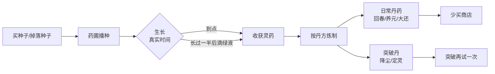

# 掌天瓶药园与炼丹方案

洞府里开 2～6 块药圃，用掌天瓶的绿液催熟灵药，收药自己炼丹：日常丹药不再全靠买，降尘丹和定灵丹有了第二个来源。

## 为什么现在做这两条

现在的丹药来源（`items.json` / `drops.json` / `quests.json` / `npcs.json` 实查）：

| 丹药 | 商店 | 掉落 | 任务 | 结果 |
| --- | --- | --- | --- | --- |
| 回春丹、回气丹、养元丹、聚气丹、大还丹、凝神丹 | 5 个 NPC 卖 | 常规怪 10%～20% | 少量奖励 | 主要靠灵石买 |
| 筑基丹 | 无 | 铁甲蛟 25%（3 分钟刷新） | 2 枚（`ch2-token`、`ch3-master`） | 能刷，不会断供 |
| 降尘丹 | 无 | 无 | 1 枚（`ch5-arrive`） | 突破最多失败 4 次，会断供 |
| 定灵丹 | 无 | 无 | 1 枚（`ch5-return`） | 突破最多失败 5 次，会断供 |

突破成功率是 60%/40%/25%，每败一次加 15%，所以最坏要 4/5/6 枚丹。突破失败会把丹吃掉（`attemptBreakthrough` 先扣材料再掷），成功率累积上去了，丹药不会自己长出来：结丹、结婴连败一次就真的停在那里。`tools/simulate.ts` 的 `breakThrough` 直接把材料补满，所以模拟里看不出这个洞。药园加炼丹是降尘丹、定灵丹断供的正解，本身不是可选装饰。

另外它符合 `design.md` 单机化设计表里“掌天瓶灵药园”的定位：挂机、闭关时药也在长，回来有东西可收，属于低成本的长线留存。

## 核心循环



三条原则：

1. **只在时间上做限制，不在操作上加负担**：播种一次、收获一次、点一下绿液。不做浇水、施肥、品质、变异。
2. **不抢商店**：炼丹成本定在商店价的 50%～70%，省下的是灵石和跑路，并非免费。
3. **不出战斗数值**：药园只产丹药，不产装备、不产经验、不产灵石。灵药卖价压到种子价的 40%，种田不是赚钱机器。

## 掌天瓶

- **来源**：完成第 1 章任务「护药驱鼠」（`ch1-herbs`，墨大夫）后开启，主题正好是识药。是否开启直接看这个任务是否完成，不另存状态。
- **不做单独升级 UI**，瓶力跟境界走：

| 境界 | 瓶级 | 凝一滴 | 绿液上限 |
| --- | --- | --- | --- |
| 练气 | 一 | 20 分钟 | 6 |
| 筑基 | 二 | 16 分钟 | 8 |
| 结丹 | 三 | 12 分钟 | 10 |
| 元婴 | 四 | 10 分钟 | 12 |

- **一滴绿液让一株已经长过一半的灵药立即成熟**，不额外产出。
  - 为什么要“长过一半”：如果刚种下就能滴，玩家会“收获、补种、滴一滴、再收”循环，一次上线把 12 滴全换成 12 茬，产量翻好几倍，龙纹草这种 6 小时的主药也就卡不住了。加上这条，绿液最多把在线时的生长速度提到两倍，离线时灵药反正会自己长熟，绿液派不上用场。
  - 策略点仍然在：滴在 30 分钟的回春草上只省 15 分钟，滴在 6 小时的龙纹草上能省 3 小时。
- 绿液在闭关期间照常凝聚，但受上限截断，因此不需要额外的 8 小时限制。

## 药园

- **地块**：初始 2 块，最多 6 块，等级加灵石扩建：

| 第 n 块 | 条件 |
| --- | --- |
| 3 | 14 级 + 2000 灵石 |
| 4 | 22 级 + 8000 灵石 |
| 5 | 30 级 + 30000 灵石 |
| 6 | 38 级 + 80000 灵石 |

- **生长用真实时间**，关掉游戏照长。但成熟后**停住**，不自动收获、不叠第二茬，避免离线一周回来爆产。
- **灵药表**（8 种，都是新物品）：

| 灵药 | 用途 | 可种等级 | 生长 | 每株收 | 种子价 | 卖价 |
| --- | --- | --- | --- | --- | --- | --- |
| 回春草 | 回春丹、养元丹 | 1 | 30 分 | 2 | 20 | 8 |
| 凝气花 | 回气丹、聚气丹 | 1 | 30 分 | 2 | 20 | 8 |
| 养元参 | 养元丹、大还丹 | 14 | 60 分 | 2 | 60 | 24 |
| 聚灵藤 | 聚气丹、凝神丹 | 14 | 60 分 | 2 | 60 | 24 |
| 金元参 | 大还丹、降尘丹 | 26 | 120 分 | 3 | 240 | 96 |
| 玄阴草 | 凝神丹、定灵丹 | 26 | 120 分 | 3 | 240 | 96 |
| 金髓草 | 降尘丹 | 26 | 300 分 | 1 | 只能掉落 | 300 |
| 龙纹草 | 定灵丹 | 34 | 360 分 | 1 | 只能掉落 | 1100 |
| 魔元草 | 魔元丹（化神突破） | 61 | 420 分 | 1 | 只能掉落 | — |

> 魔元草是第 10～12 章系统扩展补的（2026-11-05），种子挂在第 11 章魁星岛的怪身上；表里其余 8 种是第 1 批定下的。

- **等级按突破的时间点定**：降尘丹在 26 级突破结丹时要用，定灵丹在 34 级突破元婴时要用，所以相关灵药和丹方最晚在 26 级、34 级开放，不能等过了境界才开。
- **种子来源**：普通 6 种由药铺卖（面板里播种时若背包没有就地扣灵石买，省得跑图）；突破主药的种子只能掉落，不在商店卖，这样卡的是种子和时间，不是灵石：
  - 金髓草种子：外星海常规怪 15%（降尘丹在第 5 章开头突破时要用，外星海是那时的野外图）
  - 龙纹草种子：虚天殿三层常规怪 12%（34 级突破元婴时人还在虚天殿）
- **筑基丹不进药园**：玉髓芝、紫猴花、天灵果在血色禁地已经有 35%～40% 的掉率，封岳必掉天灵果，铁甲蛟还掉成品筑基丹。直接打怪凑主药比种 4 小时收 1 株快得多，再给它们做种子只是多一套没人用的数据。筑基丹的丹方照做，直接用掉落的三味主药，算一个方便。

## 炼丹

- 和药园同一面板的第二页，**随身可开**。不做丹炉地图，掌天瓶本来就是随身的，跑图只会增加往返操作。
- **必成，不做失败率**。突破已经有一层失败了，再叠一层劝退风险太高；节奏靠生长时间和绿液控制，不靠掷骰。
- 九张丹方：

| 丹药 | 材料 | 灵石 | 商店价 | 成本/枚 | 可炼等级 |
| --- | --- | --- | --- | --- | --- |
| 回春丹 | 回春草×1 | 0 | 20 | 10 | 1 |
| 回气丹 | 凝气花×1 | 0 | 20 | 10 | 1 |
| 养元丹 | 养元参×1 + 回春草×1 | 0 | 60 | 40 | 14 |
| 聚气丹 | 聚灵藤×1 + 凝气花×1 | 0 | 60 | 40 | 14 |
| 大还丹 | 金元参×1 + 养元参×1 | 30 | 150 | 110 | 26 |
| 凝神丹 | 玄阴草×1 + 聚灵藤×1 | 30 | 150 | 110 | 26 |
| 筑基丹 | 玉髓芝×1 + 紫猴花×1 + 天灵果×1 | 100 | 不卖（物品价 2000） | 禁地掉落 | 11 |
| 降尘丹 | 金髓草×1 + 金元参×1 | 500 | 不卖（物品价 8000） | 一颗种子 + 5 小时 | 26 |
| 定灵丹 | 龙纹草×1 + 玄阴草×1 | 2000 | 不卖（物品价 30000） | 一颗种子 + 6 小时 | 34 |

降尘丹、定灵丹的成本不在灵石上，靠的是“主药种子只能掉落、种一次 5～6 小时”。这样它是一条补救路径，不会把突破变成花钱买等级。

## 数值

- **产量按“每天上线 2 次”估算**，每次收获后补种：
  - 练气期 2 块回春草：每次 4 株，每天约 8 枚回春丹。
  - 元婴期 6 块地按 2.4 块金元参、3.6 块养元参配比（3×2.4 = 2×3.6），每次收获能炼约 7 枚大还丹，每天约 14 枚。
  - 在线挂机时绿液每 10 分钟一滴，一小时 6 滴正好催熟一轮 6 块地，所以在线时产量最多翻倍：每天在线 2 小时的话约 28 枚。
- **目标换成“丹药消耗”**，不用灵石收入：元婴期挂机每小时约 1 万灵石，14 枚大还丹折合 2100 灵石，只抵 0.2 小时收入，按灵石算药园永远是零头。药园的意义是少买药、少跑回城，所以目标定为：**药园日产够该阶段挂机 2～4 小时的丹药消耗**。
- **校准办法**：
  1. 先让 `tools/simulate.ts` 统计每小时吃掉多少丹药、花多少灵石买药，现在只有 `goldPerHour`，没有这项数据，丹药在挂机收益里占多大比例也还没有实测。
  2. 再给药园加一个“每日供给 N 枚该阶段丹药”的注入，跑两组对比有/无药园的回城次数和灵石曲线，落在目标区间才算通过。

## 存档与数据结构

开发期可以直接破坏存档，`SAVE_VERSION` 不动，也不写迁移，`SavedPlayer` 里加一个可选的 `garden` 字段，读档时缺了就给默认值。

```ts
export interface GardenPlot {
  /** 种下的灵药 id，空地是 null */
  herb: string | null;
  /** 真实时间毫秒 */
  plantedAt: number;
  readyAt: number;
  /** 一键补种用：这块地上次种的灵药 */
  last: string | null;
}

export interface GardenState {
  plots: GardenPlot[];
  /** 掌天瓶绿液 */
  dew: number;
  dewAt: number;
  /** 累计收获，成就用 */
  harvested: Record<string, number>;
}
```

`Player` 加 `garden: GardenState`。逻辑放在新文件 `src/game/garden.ts`，纯 TypeScript、不碰 Phaser。

**两套时钟要分开**：`World` 的 `time` 是游戏时间，闭关结算时也不往前推；药园用真实时间。真实时钟由 `World` 构造时传入（缺省 `Date.now`），再注入 `Garden`，照 `Inventory` 注入 `now` 的写法。`World` 和 `Garden` 里都不能直接调 `Date.now`，否则测试和数值模拟就不确定了，测试直接给假时钟。

对外方法：`refresh(now)`、`plant(index, herb)`、`harvest(index)`、`accelerate(index)`、`brew(recipeId)`、`expand()`、`replantAll()`、`readyCount`。`World.tick` 里每秒调一次 `refresh`（照成就检查的写法，不必每 tick 调），成熟时推事件。

时间戳防篡改：读档时把 `readyAt` 夹到 `min(readyAt, now + growSeconds)`，系统时间往回调也不会变成几万小时。

## 配置表

新增 `public/data/garden.json`：

```json
{
  "unlockQuest": "ch1-herbs",
  "dew": { "perSeconds": [1200, 960, 720, 600], "max": [6, 8, 10, 12], "minGrowth": 0.5 },
  "plots": {
    "initial": 2,
    "expansions": [
      { "level": 14, "gold": 2000 },
      { "level": 22, "gold": 8000 },
      { "level": 30, "gold": 30000 },
      { "level": 38, "gold": 80000 }
    ]
  },
  "herbs": [
    { "item": "herb-huichun", "seed": "seed-huichun", "growSeconds": 1800, "yield": 2, "level": 1 }
  ],
  "recipes": [
    {
      "id": "brew-huichun", "output": "small-potion", "count": 1, "gold": 0, "level": 1,
      "materials": [{ "item": "herb-huichun", "count": 1 }]
    }
  ]
}
```

`src/game/config.ts` 里的 `CONFIG_FILES` 加 `garden`，`GameConfig.garden` 补类型，`validateConfig` 加校验：丹方引用的物品存在、灵药都有对应种子、种子都能买到或掉落、`unlockQuest` 存在。测试会顺着这些引用报错，配错不会静默。

物品表新增 16 项：8 种灵药（`kind: 'material'`）+ 8 种种子（`kind: 'material'` + 新增可选字段 `seed: '灵药 id'`）。种子不新增 `kind`，避免动到 `useItem`、背包详情、图鉴、商店的一串 switch。种子的等级要求直接用 `ItemDef` 现有的 `level` 字段；商店过滤写在 `npcPanel.ts` 隐藏其他职业功法书的那段旁边，`buy` 也加同样的等级判断。种子的掉落挂在怪物的 `extraDrops` 上，和支线材料一样。

## 代码改动清单

| 文件 | 改动 | 量 |
| --- | --- | --- |
| `src/game/garden.ts` | 新增：地块、绿液、播种收获、炼丹、扩建、一键补种 | ~230 行 |
| `src/game/garden.test.ts` | 新增：见测试清单 | ~180 行 |
| `src/game/config.ts` | `GardenConfig` 类型、`CONFIG_FILES`、`GameConfig.garden`、`ItemDef.seed`、校验 | ~60 行 |
| `src/game/types.ts` | `Player.garden`、`GameEvent` 加 `gardenChanged` / `brewed` / `gardenReady` | ~10 行 |
| `src/game/world.ts` | 注入真实时钟、构造 `garden`、`toSave` / `restore`、每秒 `refresh`、`settleOffline` 附带药园结果 | ~50 行 |
| `src/save/saveData.ts` | `SavedPlayer.garden?` | ~3 行 |
| `src/game/sources.ts` | 灵药显示“洞府药园种植”，种子显示药铺/掉落，丹药显示“炼丹可得” | ~25 行 |
| `src/ui/gardenPanel.ts` | 新增：药园 / 炼丹两页 | ~280 行 |
| `src/ui/hud.css` | 地块卡片、生长进度、绿液条、丹方行 | ~90 行 |
| `src/ui/hud.ts` | 成熟提示行（可点开面板） | ~15 行 |
| `src/ui/panels.ts` | 灵药/种子详情里的用途与“去药园”按钮 | ~20 行 |
| `src/ui/offlineDialog.ts` | 闭关结算加一行“药园：N 株成熟，绿液 +M 滴” | ~8 行 |
| `src/ui/npcPanel.ts` | 商店按种子的 `level` 过滤 | 3 行 |
| `index.html` | 「药园 G」按钮 + 帮助文案 | 2 行 |
| `src/main.ts` | `new GardenPanel(world)` | 2 行 |
| `src/render/GameScene.ts` | 处理炼丹、成熟事件（日志 + 音效） | ~15 行 |
| `tools/make-icons.ts` | 16 个新物品的图形：灵药按阶用 `herbs-bundle` / `sprout` 等配绿/青/紫底，种子统一 `plant-seed` 配土色底 | ~30 行 |
| `tools/simulate.ts` | 统计丹药消耗和买药灵石，加药园供给开关 | ~30 行 |
| `public/data/*.json` | `garden.json` 新增；`items.json` +16；`npcs.json` 药铺加种子；`monsters.json` 两种种子的 `extraDrops`；`achievements.json` +3 | 数据 |

## 界面

- HUD 状态栏按钮列加「药园 G」，`G` 键随时开关，和 `J` 图鉴一套写法（`CodexPanel` 是现成模板）。
- 面板顶部一行：掌天瓶图标 · 「练气·一重禁制」· 绿液 4/6（下滴 12:30）。
- 药园页：2～6 张地块卡，空格显示「播种」，生长中显示图标 + 进度条 + 剩余时间 + 「绿液催熟」（没长过一半时按钮灰掉并提示还要多久），成熟显示「收获」。
- 炼丹页：九行丹方，每行显示成品图标、材料 `有/需`（不足标红）、灵石、可炼等级、炼制按钮。
- 右上角「一键补种」：按每块地上次种的灵药重播（种子不够就跳过），这是唯一必做的便利功能，否则 6 块地每次收获 6 次点选很烦。
- 刷新策略：面板每帧只更新进度条宽度和倒计时文本，DOM 重建只在地块状态或背包变化时发生（照 `NpcPanel` 的 signature 写法，但把每秒变化的量排除在外）。

## 分批

| 批次 | 内容 | 验收点 |
| --- | --- | --- |
| 1 | 掌天瓶 + 药园：地块、播种、真实时间生长、收获、绿液、扩建、存档、面板第一页 | 关掉页面 1 小时再打开，地块全熟、绿液满、能收能补种；刚种下的灵药滴不了绿液 |
| 2 | 炼丹：配置、九张丹方、面板第二页、两种突破主药种子的掉落 | 故意让结丹失败一次，用掉落的金髓草种子种出主药，再炼一枚降尘丹并突破成功 |
| 3 | 打磨：成就 3 个、物品来源、闭关结算行、HUD 成熟提示、图标、模拟统计和校准、设计文档同步 | 模拟里药园日产落在目标区间，`npm test` 与 `tsc --noEmit` 全绿 |

每批都能独立玩，第 1 批做完就已经有留存价值。

**进度**：第 1 批已完成（2026-11-04）。6 种普通灵药和种子、2～6 块药圃、绿液、扩建、一键收获和补种、存档、闭关结算行、药园面板（G 键）都已做好，`src/game/garden.test.ts` 覆盖了测试清单里药园部分。两种突破主药（金髓草、龙纹草）和丹方留到第 2 批，种子在药铺卖，也能在药园面板里直接用灵石买。

**第 2 批已完成（2026-11-05）**：
- 两种突破主药：金髓草（26 级，5 小时，每株 1）、龙纹草（34 级，6 小时，每株 1）。种子不在商店卖，药园面板里没有种子时选不了。
  - 金髓草种子：外星海三种常规怪 15%。
  - 龙纹草种子：虚天殿三层六种常规怪 12%。
- 丹方 11 张：方案里的 9 张，加回天丹（金元参×2 + 回春草，灵石 60，41 级）、玄元丹（玄阴草×2 + 凝气花，灵石 60，41 级）。这两档是第 7 章才加的丹药，用现有灵药炼，不再加新灵药。
- 第 10～12 章系统扩展又补了 3 张（2026-11-05）：玉清丹（56 级）、紫府丹（56 级）、魔元丹（魔元草 + 龙纹草，61 级，化神突破用），灵药加魔元草（61 级，7 小时，每株 1，种子只在第 11 章掉）。**当前共 9 种灵药、14 张丹方**。绿液仍是 4 档（练气到元婴），化神沿用元婴档。
- 炼丹必成，随身可炼：药园面板加「炼丹」页，每张丹方显示成品、材料有/需（不足标红）、灵石，可以炼一炉，也可以按材料一次炼完。
- 物品说明：灵药写明能炼什么，种子写明长出什么、几级可种；物品来源里加了「洞府药园种植」和「洞府炼丹」。
- 校验：每种灵药至少有一张丹方用得上，丹方的材料和成品都存在；测试覆盖炼丹扣料、多炉、等级、买不到的主药种子，以及「结丹失败一次后种金髓草、炼降尘丹、再突破」的完整流程。
- 第 3 批（药园成就、HUD 成熟提示、模拟里的药园供给和校准）还没做——`grep` 确认 `achievements.json` 里没有药园相关条目，`hud.ts` 没有成熟提示，`tools/simulate.ts` 没有丹药消耗或药园供给统计。

## 测试

- `garden.test.ts`：不到时间不能收；到点能收且数量对；收获后地块清空；绿液按间隔凝聚并截断在上限；没长过一半不能滴绿液，长过一半滴一滴只作用于指定地块；扩建扣灵石、等级不够拒绝；丹方材料不足拒绝、成功扣材料出丹；`readyAt` 被系统时间篡改时夹紧。
- 存档：`toSave` → `fromSave` 往返后地块、绿液、种子完全一致；没有 `garden` 字段的存档读进来药园可用。
- `content.test.ts` 追加：每个丹方的材料和产物都存在；每种灵药都有种子且种子有价或有掉落；每个灵药都能被至少一张丹方使用（防孤儿数据）；降尘丹、定灵丹的丹方和主药等级不晚于对应境界的突破等级；图标测试会自动覆盖 16 个新物品。
- 数值：`tools/simulate.ts` 输出丹药消耗，对比有/无药园的回城次数和灵石曲线。

## 风险

| 风险 | 影响 | 应对 |
| --- | --- | --- |
| 丹药过剩，战斗失去紧张感 | 商店和灵石都失去意义 | 产量按“每天上线 2 次”的现实节奏定，用模拟校准，别按理论满产 |
| 突破丹太便宜，突破变成等时间 | 境界推进的份量变轻 | 主药种子只能从对应章节怪掉，不在商店卖；绿液只能催熟长过一半的灵药 |
| 6 块地每次收完要补种，操作重复 | 变成负担而不是养成 | 一键补种 + 面板内直接买种子 |
| 时间戳依赖系统时钟 | 极端情况下时长异常 | 读档时夹紧 `readyAt`，单机不防作弊 |
| 数据量：16 个物品 + 9 张丹方 + 图标 | 半天到一天的体力活 | 图标按阶共用 glyph 换底色，别一个个画 |

## 暂时不做

- 炼丹失败率、丹方熟练度、出丹数量随机（可作后续增强，先把闭环跑起来）。
- 灵药品质、变异灵药、绿液洗髓等掌天瓶的其它功能。
- 筑基丹主药的种子（禁地掉落已经够用）。
- 自动收获、药童挂机（先看 6 块地的手动成本再决定）。
- 真正的洞府地图：面板标题写「洞府·药园」，等以后要做洞府时再搬进去。

## 已定的三件事

1. **炼丹必成**，不做失败率。
2. **地块上限 6 块**，绿液已限定只能催熟长过一半的灵药，不会产出过剩。
3. **灵药可卖**，卖价压到种子价的 40%，种子价高于卖价，种田刷不了灵石；两种突破主药没有种子价，卖价按物品价定。
